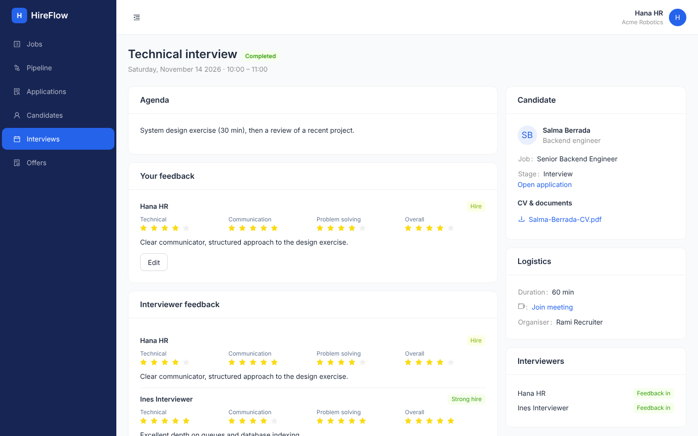
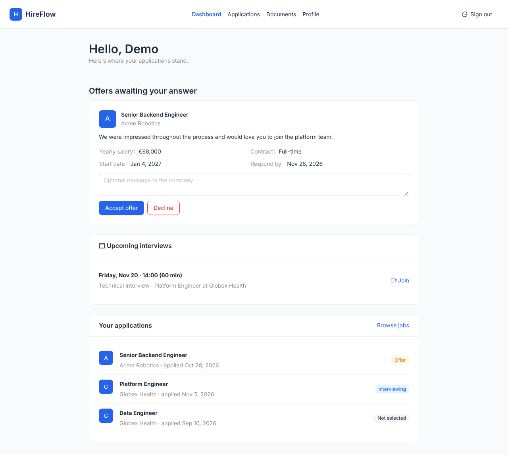
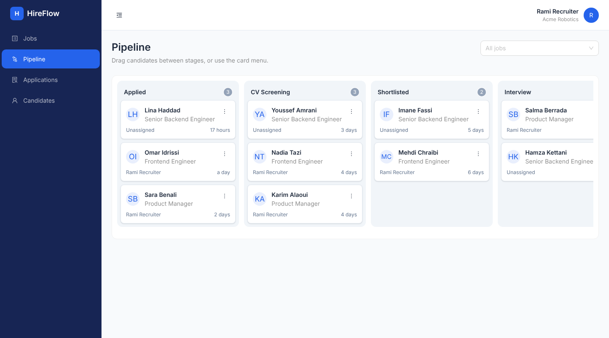
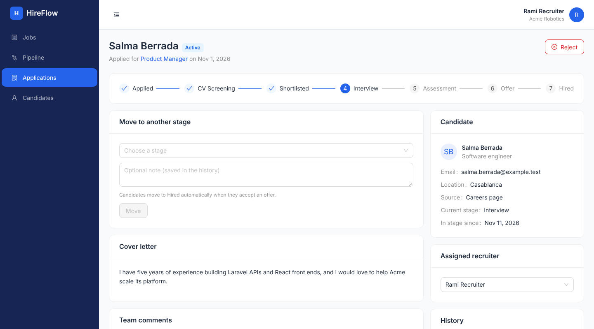
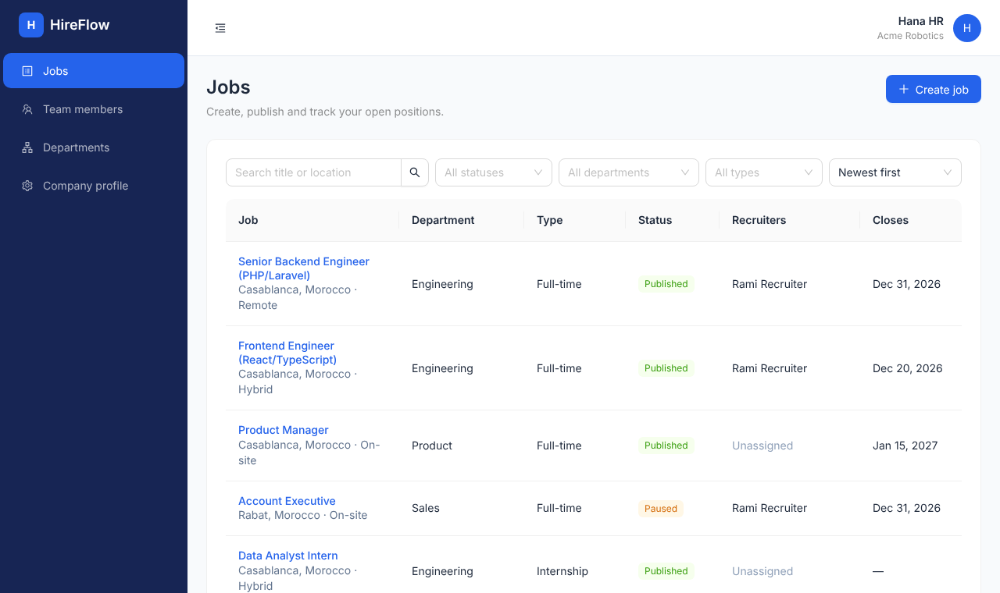
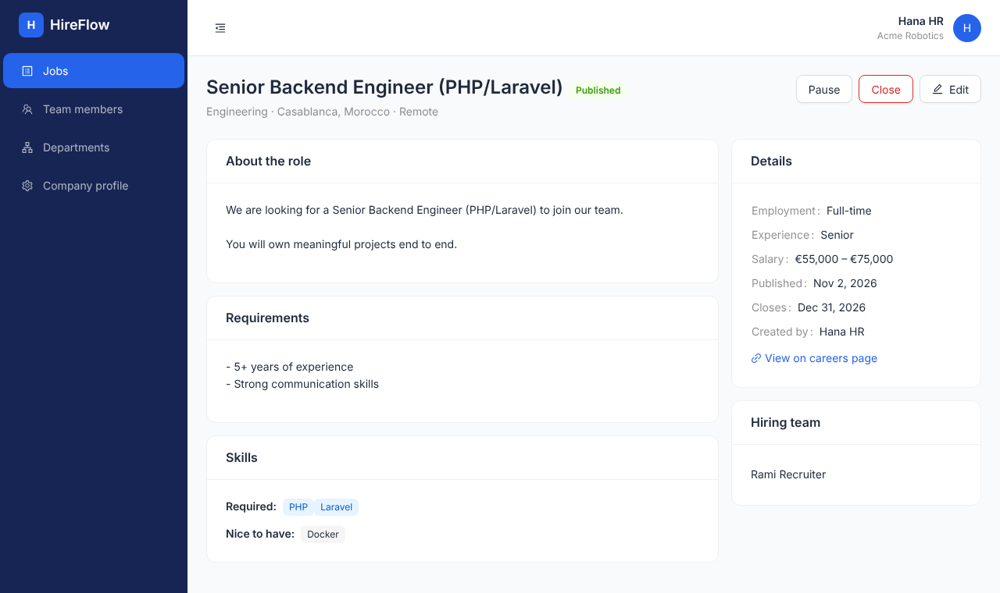
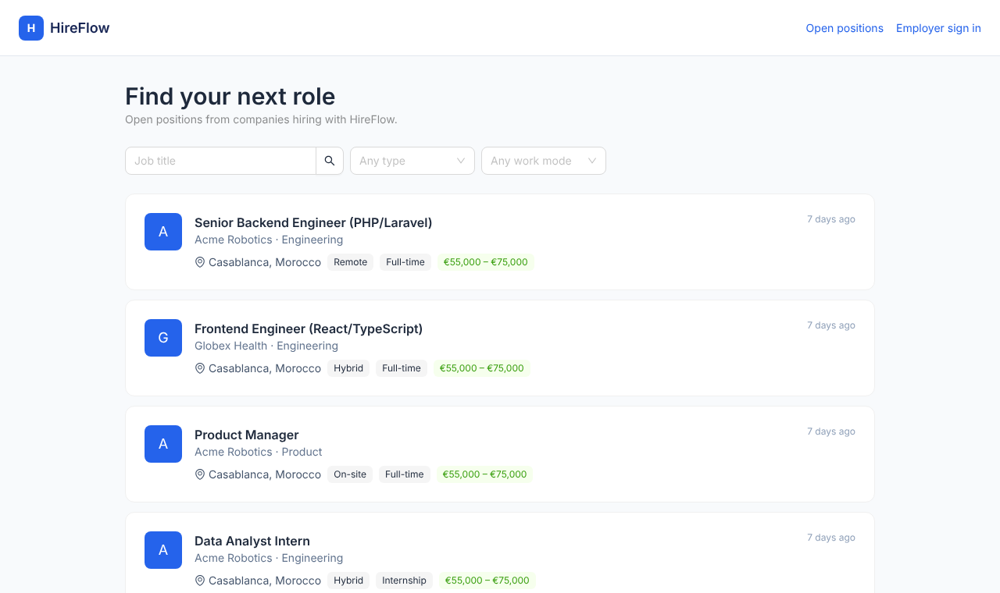
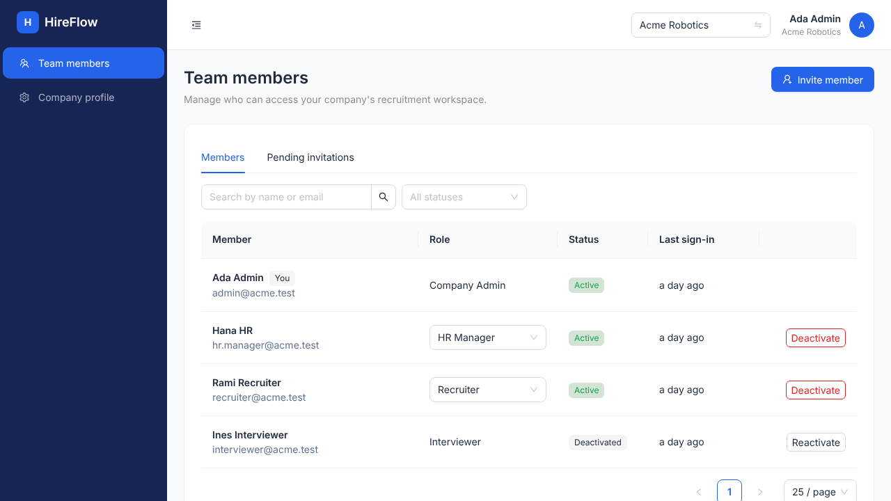

# HireFlow

HireFlow is a multi-tenant Applicant Tracking System (ATS). Companies use it to run their whole recruitment process: publishing jobs, collecting applications, running a configurable hiring pipeline, scheduling interviews, collecting interviewer feedback, and issuing offers. Each company's data is kept strictly separate.

> **Status:** Phases 1–5 (foundation, auth & multi-tenancy, jobs, candidates & applications, interviews, offers & candidate portal) written. The backend test suite still has to be run locally. Phase 6 (dashboard, analytics & notifications) is next. See [`docs/CHECKLIST.md`](docs/CHECKLIST.md).

## Stack

| Layer | Technology |
|---|---|
| Backend | Laravel 13 · PHP 8.3+ · MySQL 8 · Sanctum (SPA cookies) · Fortify · Spatie Permission (teams) |
| Frontend | React 19 · TypeScript · Vite · Ant Design 6 · Tailwind CSS 4 · TanStack Query · Zustand · React Hook Form + Zod · Recharts |
| Quality | PHPUnit · Vitest · Playwright · GitHub Actions |

## Repository layout

```
hireflow/
├── backend/    Laravel REST API (/api/v1)
├── frontend/   React SPA
├── docs/       Architecture, plan, checklist, API notes
└── .github/    CI workflows
```

## Local development (native)

Requirements: PHP 8.3+, Composer 2, MySQL 8, Node 22.12+. Full steps are in [`docs/SETUP.md`](docs/SETUP.md).

```powershell
cd backend;  composer install; copy .env.example .env; php artisan key:generate; php artisan migrate --seed
cd ..\frontend; copy .env.example .env; npm install
cd ..; .\scripts\dev.ps1     # API :8000 · queue worker · SPA :5173
```

Then open http://localhost:5173/status.

## Demo accounts

After `php artisan migrate --seed` (non-production only), every account uses the password `Password123!`:

| Role | Email |
|---|---|
| Super Admin | admin@hireflow.test |
| Company Admin | company.admin@acme.test |
| HR Manager | hr.manager@acme.test |
| Recruiter | recruiter@acme.test |
| Interviewer | interviewer@acme.test |
| Recruiter in both companies | sam.shared@hireflow.test |
| Candidate portal | candidate@example.test |

Globex Health uses the same addresses at `@globex.test`.

## Screenshots

| Interview & feedback | Candidate portal |
|---|---|
|  |  |

| Pipeline board | Application |
|---|---|
|  |  |

| Jobs | Job detail |
|---|---|
|  |  |

| Public careers page | Team members |
|---|---|
|  |  |

## Documentation

- [Architecture](docs/ARCHITECTURE.md)
- [Phase 1 plan](docs/PHASE_1_PLAN.md)
- [Development checklist](docs/CHECKLIST.md)
- [Phase 1 report](docs/PHASE_1_REPORT.md) · [Phase 2 report](docs/PHASE_2_REPORT.md) · [Phase 3 report](docs/PHASE_3_REPORT.md) · [Phase 4 report](docs/PHASE_4_REPORT.md) · [Phase 5 report](docs/PHASE_5_REPORT.md)
- [Local setup](docs/SETUP.md)
